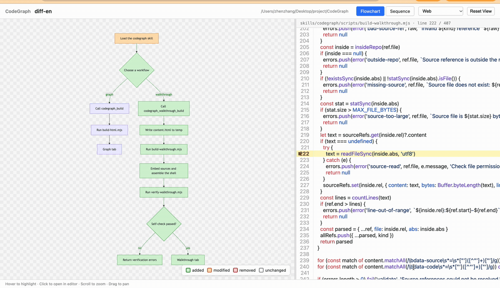
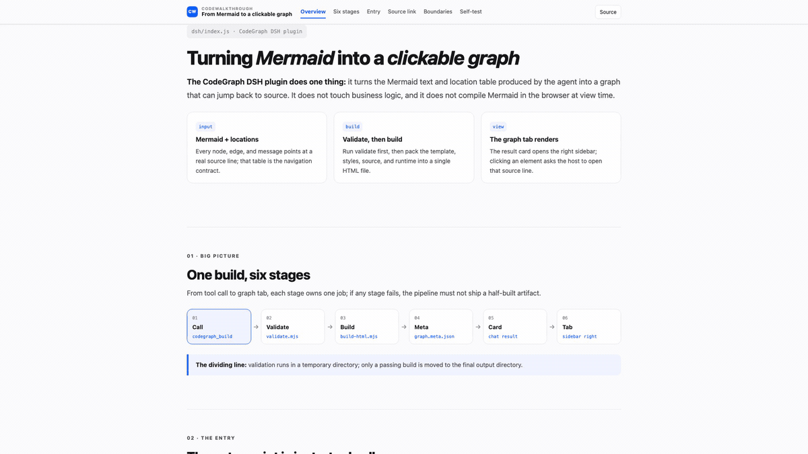

# CodeGraph

[English](README.md) · [中文](README.zh-CN.md)

> Turn a code flow into a **clickable diagram**, or a **long-form interactive explainer** — generated by your AI agent as a single offline HTML file.

CodeGraph is an Agent Skill for Claude Code, DeepSeek Harness, Cursor, Codex, and other Agent Skills-compatible agents. You describe the flow; the agent reads the code, builds the artifact, and keeps every element linked back to the source.

## Why CodeGraph

A normal diagram stops at the picture. CodeGraph keeps the connection to the code:

- **Click to source** — click a node, edge, or sequence message to open the exact source line in your editor, or in an in-page panel.
- **Review with context** — point the agent at a PR, commit, or `base..head` range and added / modified / removed elements are highlighted in the graph.
- **Two ways to explain** — use a flow diagram for structure, or switch to **CodeWalkthrough** for a scrollable explainer page with sections, inline visuals, source links, and an optional self-test.

Everything is generated as one self-contained HTML file. There is no server, CDN, or runtime `npm install` on the viewer's machine, and the artifact works offline.

## Demo



**Review-mode flowchart.** Green is added, orange is modified, gray is unchanged. Clicking a node opens the referenced source line.


**Sequence diagram.** Same review colors, with actors, messages, and clickable source locations.


## Flow diagrams

Ask the agent to draw a flow and it produces a single `graph.html`:

- flowchart, sequence, or UML class diagram;
- zoom, pan, hover, and click-to-source;
- review mode for PRs, commits, and diffs;
- works in any browser, online or offline.

## CodeWalkthrough: turn code into a course

CodeWalkthrough is not a summary of a file. It is a small course generated from
the codebase, built around three ideas:

- **Shallow to deep** — open with a one-paragraph mental model, then a
  big-picture diagram, a running example, the mechanisms, the boundaries, and a
  recap. Each section makes one point.
- **Visual first** — data flow, state transitions, and call chains become inline
  SVG/CSS/JS diagrams and animations. Code is an exhibit, not the main text.
- **Practice to verify** — an optional 3–5 question self-test, with multiple
  choice or click-to-reveal answers that explain why and link back to source.

One running example is reused across the page, and every key claim links to a
source line. The output is a single `walkthrough.html` that works offline.

Use it for onboarding, explaining a module, or turning a design review into a
reusable lesson.



## Install

### Claude Code

```bash
claude plugin marketplace add longbowzz/CodeGraph
claude plugin install codegraph@codegraph
```

Inside a session, `/plugin install codegraph@codegraph --marketplace longbowzz/CodeGraph`
does both steps.

### Any Agent Skills-compatible agent

```bash
npx skills add longbowzz/CodeGraph --skill codegraph
```

Run it from the target project. Add `-g` to install globally, or
`-a claude-code` to skip the agent picker.

### DeepSeek Harness

```bash
dsh plugin --profile web add -w @longbowzz/dsh-codegraph
```

The `-w` flag adds the bundle to the profile's workspace root; pnpm requires it
on some DSH builds. The bundle also adds the `codegraph_build`,
`codegraph_walkthrough_build`, and `codegraph_list` tools, result cards, and a
right-sidebar graph/walkthrough tab. See [`dsh/README.md`](dsh/README.md).

### Requirements

- **Node.js 18+** for the skill scripts. No runtime `npm install` is needed to
  generate or view artifacts.
- **Node.js 22.20+** for the `npx skills` CLI.
- A supported editor for click-to-source (VS Code, Cursor, JetBrains IDEs), or
  choose the **Web** editor to open source in an in-page panel.
- **DeepSeek Harness 0.2.x** for the DSH bundle.

## Use

Just talk to your agent in the repository you want to analyze:

> Use CodeGraph to draw the login flow as a sequence diagram.

> Review PR #123 with CodeGraph — highlight what changed.

> Use CodeGraph to explain the refund flow as an interactive webpage.

The first run may ask which editor to use. Choose **Web** if you do not have a
supported editor installed.

The result is written under `.codegraph/output/` in the target repository. In
DSH, a result card opens the graph or walkthrough in the right sidebar; in other
agents, open the reported HTML file in a browser.

## Notes and limits

- The agent writes the Mermaid text and the source-location table; the validator
  checks syntax, structure, paths, and line ranges. It cannot prove that a label
  matches the business meaning — the agent reads the code for that.
- Review colors: **green = added**, **orange = modified**, **gray = unchanged**.
- Artifacts are snapshots of the current checkout. Rebuild after the code moves.
- CodeWalkthrough asks a few intake questions first; the self-test is optional
  and must be requested.
- In DSH, the analyzed repository must stay inside the session workspace.
- CodeGraph is not a generic “draw a diagram” trigger. Mention CodeGraph (or ask
  for a CodeWalkthrough) so the skill activates.

## Learn more

- [Agent contract](skills/codegraph/SKILL.md) — the full graph workflow and supported Mermaid subset.
- [CodeWalkthrough contract](skills/codegraph/references/walkthrough.md) — intake, structure, and self-check.
- [DeepSeek Harness bundle](dsh/README.md) — tools, cards, tabs, and configuration.
- [Example CodeWalkthrough body](skills/codegraph/examples/walkthrough-sample.html).
- Found a bug or have an idea? [Open an issue](https://github.com/longbowzz/CodeGraph/issues).

## Development

```bash
npm test          # parser, validator, diff, HTML build, CLI
npm run build:mermaid
```

Browser suites require Playwright and Chromium; see
[`skills/codegraph/scripts`](skills/codegraph/scripts) for the entry points.

## License

MIT. See [LICENSE](LICENSE).
