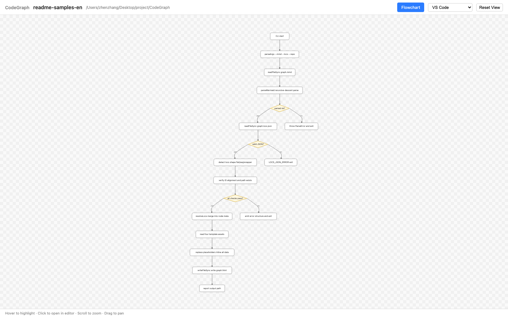
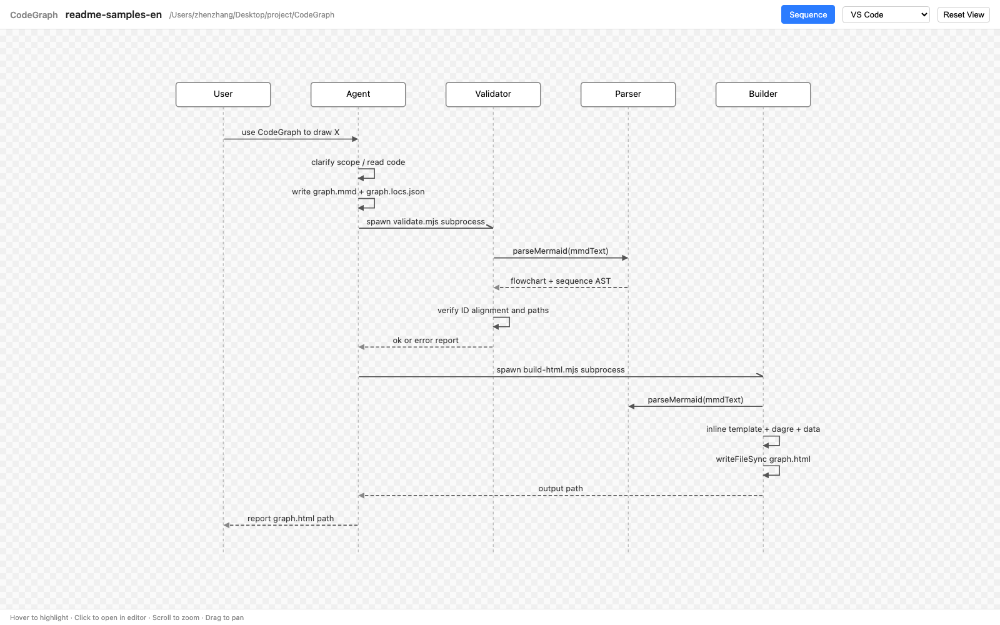
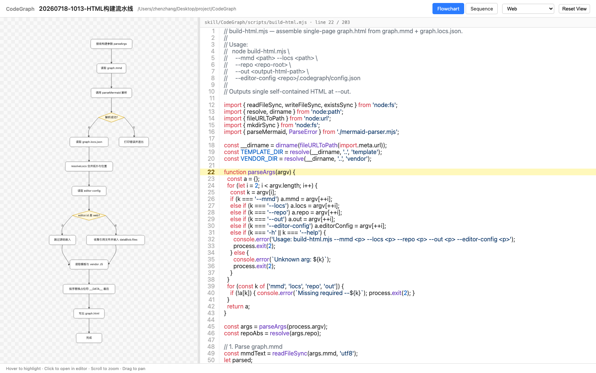

# CodeGraph

[English](README.md) · [中文](README.zh-CN.md)

> Generate interactive, single-page flowchart and sequence-diagram HTML from any codebase, with click-to-jump-to-source in your editor. An AI agent reads your code and produces the graph; this repo provides the skill, validator, and HTML builder.

## What it does

Turn a request like *"use CodeGraph to draw the login flow as a flowchart"* into a self-contained `graph.html` you can open in any browser:

- The agent reads your repo and produces two artifacts:
  - `graph.mmd` — a flowchart and/or sequence diagram using the supported portion of official Mermaid syntax (see [Mermaid support](#mermaid-support)).
  - `graph.locs.json` — exact semantic source locations for flowchart nodes and edges, and sequence actors and messages (`[file, line, status?]`).
- A validator checks Mermaid syntax, location structure, ID/edge alignment, paths, and line ranges. The agent reads source context to verify that labels describe the referenced statements; validation cannot prove natural-language semantics.
- A builder inlines the vendored Mermaid engine, renderer, styles, and graph data into one HTML file with zoom / pan / hover / click-to-jump.

**Review mode**: give the agent a PR, commit, or `base..head` range and it highlights added / modified / removed nodes and edges so reviewers see the change in context.

The HTML has **zero runtime dependencies** — no server, no CDN, no `npm install` on the viewer's machine.

### Mermaid support

CodeGraph uses the official Mermaid **11.12.0** engine, fixed and vendored with the skill; see [`vendor/mermaid-manifest.json`](skill/CodeGraph/vendor/mermaid-manifest.json) for bundle details. The supported contract is Mermaid syntax accepted by that pinned version and representable in CodeGraph's flowchart / sequence view. Each file may contain one flowchart and/or one sequence diagram; other diagram types are outside this contract.

Common constructs include flowcharts with `graph` / `flowchart` headers in `TD`, `TB`, `BT`, `LR`, or `RL`, common node shapes, labeled and styled edges, chains, subgraphs, classes, quoted and multiline labels; and sequence diagrams with actor / participant declarations (including implicit participants), activation, notes, `loop`, `alt`, `opt`, `par`, `critical`, and `break` fragments, `rect` / `box` grouping, and `autonumber`. This is a representative list, not a complete compatibility table; CodeGraph imposes no arbitrary two-level nesting limit. Use syntax accepted by the pinned engine and simplify constructs the source-navigation view cannot represent faithfully.

Source mappings remain exact and complete for semantic flowchart nodes and edges, and sequence actors and messages. Subgraph / group containers, notes, and fragment markers are visual-only and do not need locations. Rendering uses Mermaid strict security. Mermaid callbacks and links do not replace CodeGraph's source navigation. External ELK layouts and image / icon assets are not bundled; external images and icons are not guaranteed to work offline.

Mermaid and the other browser assets are vendored into generated HTML, so generation and viewing need no runtime `npm install` or network access. Development dependencies for rebuilding the vendored assets are separate.

### Example output

**Flowchart** (zoom / pan / hover / click any node to jump to its source line):



**Sequence diagram** (sync / return / async arrows, hover the line or the label):



## Install

### Requirements

- **Node.js 18+** (uses native `node:*` ESM imports; no `npm install` needed for graph generation or viewing — development build dependencies are separate).
- A supported editor for click-to-jump (see below).
- An AI agent that supports skills (e.g. Claude Code), or run the scripts manually.

### Add to Claude Code

Clone the repo, then symlink (or copy) the skill into your Claude skills directory:

```bash
git clone https://github.com/longbowzz/CodeGraph.git
ln -s "$(pwd)/CodeGraph/skill/CodeGraph" ~/.claude/skills/CodeGraph
```

Or copy the `skill/CodeGraph/` directory into a project-local `.claude/skills/CodeGraph/`.

### DeepSeek Harness plugin

The [`dsh/`](dsh/README.md) bundle adds CodeGraph to DeepSeek Harness:

- a `codegraph` runtime skill and `codegraph_build` / `codegraph_list` tools;
- a chat result card for every build;
- a right-sidebar graph tab; clicking a node, edge, message, or actor opens that
  source line in the Harness preview.

Install the local bundle from DSH by asking the agent:

> Install the CodeGraph plugin bundle from `/absolute/path/to/CodeGraph/dsh`.

The agent performs this with the plugin manager
(`plugin_manager install_bundle /absolute/path/to/CodeGraph/dsh`). The bundle is
installed as a linked local package and reuses `skill/CodeGraph` in place; keep
the checkout at that path, or reinstall after moving it.

Then ask:

> Use CodeGraph to draw the login flow as a sequence diagram.

The agent loads the `codegraph` skill, produces the graph, and returns a card.
Click **Open graph**, then click any graph element to jump to its source line.
If the skill, tools, or graph tab do not appear, reload the DSH page.

See [`dsh/README.md`](dsh/README.md) for configuration and limitations.

### Verify

```bash
node CodeGraph/skill/CodeGraph/scripts/_smoke-parser.mjs
node CodeGraph/skill/CodeGraph/scripts/_smoke-validate.mjs
```

Both should report all-pass.

## Usage

### Via Claude Code skill (recommended)

In any repo you want to analyze, just say:

> Use the CodeGraph skill to draw the X flow as a flowchart / sequence diagram.

The agent will:

1. Ask you to pick an editor the first time (writes `.codegraph/config.json`).
2. Clarify scope with you (≤ 3 rounds).
3. Read your code and produce `graph.mmd` + `graph.locs.json`.
4. Validate, retry on errors, build the HTML.
5. Report the output path.

### Manual

```bash
node skill/CodeGraph/scripts/validate.mjs \
  --mmd path/to/graph.mmd \
  --locs path/to/graph.locs.json \
  --repo /path/to/your/repo

node skill/CodeGraph/scripts/build-html.mjs \
  --mmd path/to/graph.mmd \
  --locs path/to/graph.locs.json \
  --repo /path/to/your/repo \
  --out path/to/graph.html \
  --editor-config /path/to/your/repo/.codegraph/config.json
```

## Location data format

The recommended flowchart format separates node locations from edge locations:

```json
{
  "flowchart": {
    "nodes": {
      "A": ["src/handler.ts", 12],
      "B": ["src/auth.ts", 8, "modified"]
    },
    "edges": [
      {"from": "A", "to": "B", "occurrence": 1, "loc": ["src/handler.ts", 25, "modified"]}
    ]
  }
}
```

For `A --> B`, this maps the edge to the actual call in the handler. Each location
is `[file, line]` or `[file, line, status]`: paths are relative to the analyzed repo,
lines are 1-based and within the file, and optional status is `added`, `modified`,
`removed`, or `unchanged` (the default). A single flowchart also accepts unwrapped
`{ "nodes": {...}, "edges": [...] }`. The new format requires exactly one location
record for **every edge**, including unlabeled, dashed, repeated, and chained edges.

Edge identity is `JSON.stringify([from, to, occurrence])`. `occurrence` counts
from 1 **per directed endpoint pair**, in Mermaid order, expanding chains left to
right. For `A --> B --> A` followed by `A --> B`, the identities are
`["A","B",1]`, `["B","A",1]`, and `["A","B",2]`. Unrelated edges do not change
the counter. Reordering edges with the same directed endpoints requires
regenerating their matching location records; labels and styles are not identity.

Sequence diagrams use `{ "actors": { ... }, "messages": [...] }`; message
locations follow message-arrow order exactly. For both diagram types in one
Mermaid file, use `{ "flowchart": { "nodes": {...}, "edges": [...] },
"sequence": { "actors": {...}, "messages": [...] } }`.

Behavior nodes must point to the actual statements implementing their labels;
only entry/declaration nodes may use definition lines. Edges point to actual
caller-side calls, publishes, branches, or returns, and sequence messages to
where the send/call/return actually happens. Locations may repeat for the same
real statement. The generating agent must read the surrounding source to verify
each reference, never invent a location or substitute a convenient function
header. If one source location cannot express an element faithfully, split the
diagram or narrow its semantics. The validator checks structure, paths, and line
ranges; it cannot prove this semantic correspondence.

**Legacy input:** old flat node maps (`{ "A": [file, line], ... }`, also inside a
`flowchart` wrapper) remain readable. Their edges use an **approximate source
fallback**. New generation uses explicit `nodes`/`edges` with full edge coverage.
See [the skill contract](skill/CodeGraph/SKILL.md#4-graphlocsjson-format) for paired
flowchart and sequence examples.

## Output structure

```
<repo>/.codegraph/
├── config.json                              # editor choice (auto-generated)
└── output/
    └── <YYYYMMDD-HHMM>-<topic-slug>/
        ├── graph.mmd                        # topology
        ├── graph.locs.json                  # file:line lookup
        └── graph.html                       # final single-page output
```

Each invocation produces a new timestamped subdirectory — history is preserved, never overwritten.

## Supported editors

Click-to-jump uses OS-level URL schemes (no helper app required).

| Editor | URL scheme | macOS out-of-box |
|---|---|---|
| VS Code | `vscode://file...` | ✅ |
| VS Code Insiders | `vscode-insiders://file...` | ✅ |
| Cursor | `cursor://file...` | ✅ |
| IntelliJ IDEA | `idea://open?...` | ✅ |
| PyCharm | `pycharm://open?...` | ✅ |
| WebStorm | `webstorm://open?...` | ✅ |
| GoLand / PhpStorm / Rider / CLion / RubyMine | `<product>://open?...` | ✅ |
| **Web (in-browser)** | — | ✅ |

The **Web** editor doesn't launch an external app. Instead, the builder embeds
every source file referenced by the graph into the HTML at build time, and
clicking a node opens the source in a right-side code panel inside the same
browser tab — syntax-highlighted and scrolled to the target line. A draggable
splitter divides the canvas from the code (default canvas:code = 1:2; double-click
the splitter to reset). Use this when no supported editor is installed locally.



**Not supported** (no native URL scheme): Sublime, Zed, Neovim, Vim, Trae.

> Safari shows a confirmation prompt on every click. Chrome / Firefox / Edge ask once and remember. Recommend Chrome for frictionless jumping.

## Project layout

```
CodeGraph/
├── skill/CodeGraph/
│   ├── SKILL.md                  # Agent instructions
│   ├── scripts/
│   │   ├── mermaid-parser.mjs    # Mermaid syntax parser and graph model
│   │   ├── validate.mjs          # Schema + ID + path validator
│   │   ├── build-html.mjs        # Single-page HTML builder
│   │   ├── _smoke-parser.mjs     # Parser tests
│   │   └── _smoke-validate.mjs   # Validator tests
│   ├── template/
│   │   ├── page.html
│   │   ├── render.js             # SVG renderer + zoom/pan + click handler
│   │   └── styles.css
│   └── vendor/
│       ├── mermaid-manifest.json # Pinned version and bundle metadata
│       ├── mermaid.min.js        # Fixed official Mermaid browser bundle
│       ├── mermaid-parser.bundle.mjs # Official Mermaid parser for Node.js
│       └── highlight.min.js      # Bundled highlight.js (source code panel)
├── images/                       # README screenshots
├── LICENSE
└── README.md
```

## Contributing

Issues and PRs welcome. Run the script regression suite from the repository root before submitting:

```bash
npm test
```

This requires Node.js and Git, with no dependency install or browser. It covers Mermaid parsing, location validation and format compatibility, Git diff extraction, HTML building, source embedding/escaping, and output verification. Fixtures use temporary directories and are cleaned up. Pull requests and pushes to `main` run the same suite on Node.js 18 and 22 through GitHub Actions.

For `WORKTREE` reviews, staged and unstaged changes are included; untracked files appear only after `git add`. Diff regressions cover deletions, renames, multiple hunks, line insertions/deletions, missing final newlines, spaces/Unicode in filenames, and invalid references. CLI tests verify argument errors, exit codes, and structured validation failures.

For renderer, template, or vendor changes, also run the browser suites with a Python environment containing Playwright and Chromium:

```bash
python3 -I skill/CodeGraph/scripts/_semantic-location-test.py
python3 -I skill/CodeGraph/scripts/_mermaid-browser-test.py
```

These create their own fixtures and check real source clicks, diagram geometry, review mode, themes, and offline rendering. Rebuilding vendored assets remains a separate development check: `npm ci --ignore-scripts && npm run build:mermaid`.

## License

[MIT](LICENSE).
