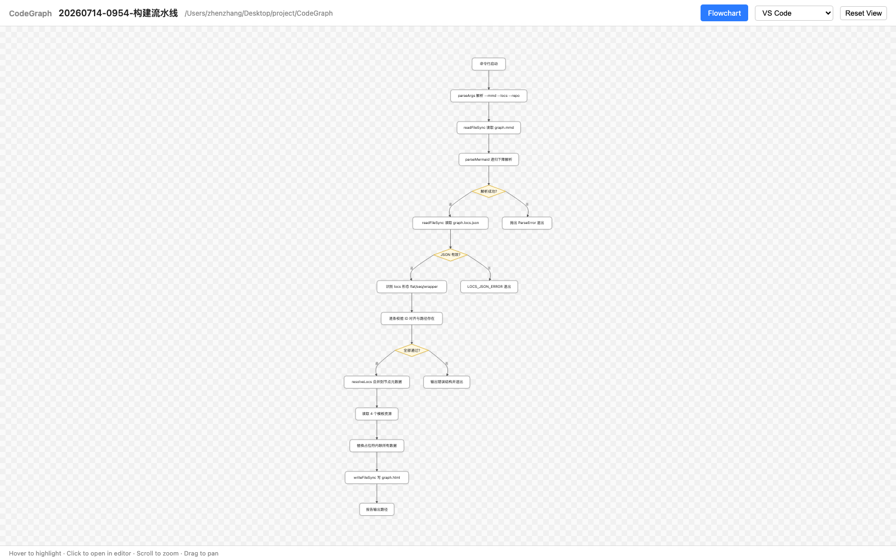
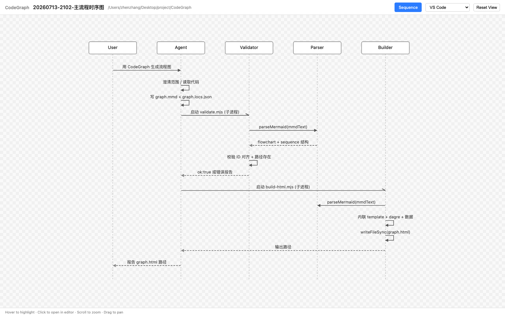

# CodeGraph

[English](README.md) · [中文](README.zh-CN.md)

> 用 AI Agent 阅读你的代码，生成交互式单页流程图 / 时序图 HTML，点击节点直接跳转到编辑器对应代码位置。本仓库提供 Skill、校验器和 HTML 构建器。

## 它能做什么

把一句 *"用 CodeGraph 画一下登录流程的流程图"* 变成一个自包含的 `graph.html`，任何浏览器都能打开：

- Agent 读取你的仓库，产出两个文件：
  - `graph.mmd` — 使用官方 Mermaid 引擎支持的语法部分来描述流程图和/或时序图（见 [Mermaid 支持范围](#mermaid-支持范围)）。
  - `graph.locs.json` — 流程图节点与边、时序图参与者与消息的精确语义源码位置（`[file, line, status?]`）。
- 校验器检查 Mermaid 语法、位置结构、ID/边对齐、路径和行号范围。Agent 会阅读源码上下文，确认标签与所指语句相符；校验器无法证明自然语言语义。
- 构建器把 vendored Mermaid 引擎、渲染器、样式和图数据内联到一个 HTML 文件里，自带缩放 / 平移 / hover / 点击跳转。

**评审模式**：向 Agent 提供 PR、commit 或 `base..head` 范围，它会用绿 / 橙 / 红高亮新增、修改、删除的节点与边，让评审者一眼看清改动在整体流程中的位置。

**CodeWalkthrough**（第二个 workflow）：让 agent 讲解一个模块或流程，生成单文件、上下滚动的长文
讲解页，内联 SVG/CSS/JS 与源码引用；普通浏览器有可折叠的右侧源码分栏，DSH 中则打开自带
源码 pane。初始询问可以要求加 3–5 道自测题，放在最后，支持选项判分或点击查看答案。

生成的 HTML **零运行时依赖** —— 不需要服务器、CDN，查看方无需 `npm install`。

### Mermaid 支持范围

CodeGraph 使用固定版本、随项目 vendored 的官方 Mermaid **11.12.0** 引擎，打包详情见 [`vendor/mermaid-manifest.json`](skill/CodeGraph/vendor/mermaid-manifest.json)。支持范围是该固定版本接受、且 CodeGraph 流程图 / 时序图视图能够表达的 Mermaid 语法，每个文件最多包含一张流程图和/或一张时序图，其他图类型不在本契约范围内；也不代表支持 Mermaid 的所有功能。

常见构造包括：`graph` / `flowchart` 的 `TD`、`TB`、`BT`、`LR`、`RL` 方向、常见节点形状、带标签和样式的边、边链、子图、class 样式、引号包裹的标签和多行标签；以及包含 actor / participant 声明（含隐式参与者）、激活、注释、`loop`、`alt`、`opt`、`par`、`critical`、`break` 片段、`rect` / `box` 分组和 `autonumber` 的时序图。此列表仅列举常见语法，并非完整兼容性清单；CodeGraph 不额外施加两层嵌套上限。请使用固定引擎版本接受、且源码导航视图能够忠实表达的语法。

源码映射仍须为有语义的流程图节点和边、时序图参与者和消息精确且完整地提供。子图 / 分组容器、注释和片段标记仅用于视觉呈现，无需源码位置。渲染采用 Mermaid strict 安全模式。Mermaid 回调和链接不会取代 CodeGraph 的源码导航。外部 ELK 布局和图片 / 图标资源未打包，外部图片和图标离线时不保证可用。

Mermaid 及其他浏览器资源会 vendored 到生成的 HTML 中，因此生成和查看时不需要运行时 `npm install` 或联网。用于重建 vendored 资源的开发依赖另行管理。

### 示例输出

**流程图**（缩放 / 平移 / hover / 点击任意节点跳转到对应源码行）：



**时序图**（支持同步 / 返回 / 异步三种箭头，hover 线条或文字均可）：



## 安装

### 环境要求

- **Node.js 18+**（运行时使用 `node:*` 内置 ESM；生成图和查看 HTML 无需 `npm install`，开发构建依赖另行管理）。
- 一个支持 URL scheme 的编辑器（见下表）。
- 支持 Skill 的 AI Agent（如 Claude Code），或手动运行脚本。

### 添加到 Claude Code

克隆仓库后，把 Skill 软链或复制到 Claude 的 skills 目录：

```bash
git clone https://github.com/longbowzz/CodeGraph.git
ln -s "$(pwd)/CodeGraph/skill/CodeGraph" ~/.claude/skills/CodeGraph
```

或把 `skill/CodeGraph/` 目录复制到目标项目的 `.claude/skills/CodeGraph/`。

### DeepSeek Harness 插件

[`dsh/`](dsh/README.zh-CN.md) 把 CodeGraph 接入 DeepSeek Harness：

- `codegraph` 运行时 Skill，以及 `codegraph_build` / `codegraph_list` 画图工具；
- `codegraph_walkthrough_build` 工具，用于生成长文式、可交互的 CodeWalkthrough 讲解页；
- 每次构建的对话结果卡片；
- 右侧栏图/讲解页 tab；点击源码引用会在 Harness 源码预览中打开对应行。

在 DSH 里让 agent 安装本地 bundle：

> 安装 `/绝对路径/CodeGraph/dsh` 的 CodeGraph 插件。

底层由 agent 调用插件管理器执行
`plugin_manager install_bundle /绝对路径/CodeGraph/dsh`。bundle 以链接方式安装，
直接复用当前 checkout 的 `skill/CodeGraph`；移动 checkout 后需要重新安装。

然后直接说：

> 用 CodeGraph 画一下登录流程的时序图。

agent 会加载 `codegraph` Skill、生成图并返回卡片。点 **Open graph**，再点图中的节点/箭头/消息即可跳到对应源码行。如果 Skill、工具或图 tab 没出现，刷新一次 DSH 页面。

如果要的是一篇讲解网页而不是图，可以说：

> 用 CodeGraph 为我介绍退款流程，做成一个可交互的网页。

agent 会先问几个问题明确读者、范围、深度，再阅读相关代码和测试，生成单文件
`walkthrough.html`：上下滚动的长文、内联 SVG/CSS/JS、源码引用。普通浏览器中有可折叠的右侧
源码分栏；DSH 中使用自带源码 pane。交付前会做静态和运行时自检。详见
[CodeWalkthrough 契约](skill/CodeGraph/references/walkthrough.md)。

配置与限制见 [`dsh/README.zh-CN.md`](dsh/README.zh-CN.md)。

### 验证

```bash
node CodeGraph/skill/CodeGraph/scripts/_smoke-parser.mjs
node CodeGraph/skill/CodeGraph/scripts/_smoke-validate.mjs
```

两个都应该全部通过。

## 使用

### 通过 Claude Code Skill（推荐）

在任意你想分析的项目里，直接说：

> 用 CodeGraph 技能生成 X 流程的流程图 / 时序图

Agent 会：

1. 首次让你选择编辑器（写入 `.codegraph/config.json`）。
2. 和你对齐范围（最多 3 轮）。
3. 读取代码，产出 `graph.mmd` + `graph.locs.json`。
4. 校验，失败重试，构建 HTML。
5. 报告输出路径。

### 手动

```bash
node skill/CodeGraph/scripts/validate.mjs \
  --mmd path/to/graph.mmd \
  --locs path/to/graph.locs.json \
  --repo /path/to/your/repo

node skill/CodeGraph/scripts/build-html.mjs \
  --mmd path/to/graph.mmd \
  --locs path/to/graph.locs.json \
  --repo /path/to/your/repo \
  --out path/to/graph.html \
  --editor-config /path/to/your/repo/.codegraph/config.json
```

#### CodeWalkthrough

CodeWalkthrough 是同一个 Skill 的第二个 workflow。Agent 先写一个内容 HTML 片段，
用 `section.cw-section` 分节，用 `data-source` / `data-code` 引用源码，然后构建：

```bash
node skill/CodeGraph/scripts/build-walkthrough.mjs \
  --content path/to/content.html \
  --repo /path/to/your/repo \
  --topic "退款流程" \
  --language zh

node skill/CodeGraph/scripts/verify-walkthrough.mjs \
  --file /path/to/your/repo/.codegraph/output/<stamp>-退款流程/walkthrough.html \
  --repo /path/to/your/repo
```

产物是单个 `walkthrough.html`；普通浏览器中有可折叠的源码分栏，DSH 中使用自带
源码 pane。详见 [CodeWalkthrough 契约](skill/CodeGraph/references/walkthrough.md)。

## 源码位置数据格式

推荐的流程图格式分别记录节点位置和边位置：

```json
{
  "flowchart": {
    "nodes": {
      "A": ["src/handler.ts", 12],
      "B": ["src/auth.ts", 8, "modified"]
    },
    "edges": [
      {"from": "A", "to": "B", "occurrence": 1, "loc": ["src/handler.ts", 25, "modified"]}
    ]
  }
}
```

对于 `A --> B`，这里的边位置指向 handler 中实际发生调用的语句。每个位置为 `[file, line]` 或 `[file, line, status]`：路径相对于被分析仓库，行号从 1 开始且位于文件范围内，可选状态为 `added`、`modified`、`removed` 或默认的 `unchanged`。单独一张流程图也接受不带外层包装的 `{ "nodes": {...}, "edges": [...] }`。新格式必须为**每一条边**提供且仅提供一条位置记录，包括无标签、虚线、重复和链式展开后的边。

边的标识为 `JSON.stringify([from, to, occurrence])`。`occurrence` 按 Mermaid 中的顺序，针对**每一对有向端点分别从 1 计数**，链式边从左到右展开。例如先有 `A --> B --> A`，再有 `A --> B`，标识依次为 `["A","B",1]`、`["B","A",1]`、`["A","B",2]`。无关边不影响计数；同一对有向端点的边重新排序时，必须同步更新位置记录。标签和样式不参与标识。

时序图使用 `{ "actors": {...}, "messages": [...] }`，为所有显式或隐式参与者提供位置；消息位置严格按消息箭头顺序排列。同一文件包含两种图时，使用 `{ "flowchart": { "nodes": {...}, "edges": [...] }, "sequence": { "actors": {...}, "messages": [...] } }`。分组、注释和片段标记仅用于视觉呈现，不计入消息数量或源码映射。

行为节点必须指向真正实现标签含义的语句；只有入口 / 声明节点可以指向定义行。边指向调用方实际发生调用、发布、分支或返回的语句，消息指向发送 / 调用 / 返回实际发生处。同一条真实语句可以被多处引用。Agent 必须阅读源码上下文来核对每个位置，不得编造位置或用方便的函数头代替；如果单一位置无法忠实表达含义，应拆图或收窄语义。校验器检查结构、路径和行号范围，无法证明语义对应关系。

**旧格式兼容**：旧的扁平节点映射（`{ "A": [file, line], ... }`，也可以放在 `flowchart` 包装内）仍可读取，其边使用**近似源码位置回退**。新生成的图应使用完整覆盖所有边的显式 `nodes` / `edges` 格式。配对示例见 [Skill 契约](skill/CodeGraph/SKILL.md#4-graphlocsjson-format)。

## 输出结构

```
<repo>/.codegraph/
├── config.json                              # 编辑器选择（自动生成）
└── output/
    └── <YYYYMMDD-HHMM>-<topic-slug>/
        ├── graph.mmd                        # 拓扑（图 workflow）
        ├── graph.locs.json                  # file:line 查表（图 workflow）
        ├── graph.html                       # 最终图产物
        ├── walkthrough.html                 # CodeWalkthrough 产物
        ├── walkthrough.meta.json            # CodeWalkthrough 元数据
        └── walkthrough.content.html         # 内容 HTML 片段
```

每次调用都会产生一个新的时间戳子目录 —— 历史保留，不会覆盖。

## 支持的编辑器

点击跳转通过 OS 级 URL scheme 实现（不需要辅助 App）。

| 编辑器 | URL scheme | macOS 开箱即用 |
|---|---|---|
| VS Code | `vscode://file...` | ✅ |
| VS Code Insiders | `vscode-insiders://file...` | ✅ |
| Cursor | `cursor://file...` | ✅ |
| IntelliJ IDEA | `idea://open?...` | ✅ |
| PyCharm | `pycharm://open?...` | ✅ |
| WebStorm | `webstorm://open?...` | ✅ |
| GoLand / PhpStorm / Rider / CLion / RubyMine | `<product>://open?...` | ✅ |
| **Web（浏览器内）** | — | ✅ |

**Web** 编辑器不会启动外部应用。构建时会把图里引用到的源文件全部嵌入 HTML，点击节点时直接在同一浏览器标签页右侧的代码面板里打开源码——语法高亮、自动滚到目标行。画布与代码之间有可拖拽的分隔条（默认画布:代码 = 1:2，双击分隔条可重置）。本地没有装受支持的编辑器时推荐用这个模式。


**不支持**（没有原生 URL scheme）：Sublime、Zed、Neovim、Vim、Trae。

> Safari 每次点击都会弹确认框；Chrome / Firefox / Edge 只问一次并记住。推荐用 Chrome 获得最顺滑的跳转体验。

## 项目结构

```
CodeGraph/
├── skill/CodeGraph/
│   ├── SKILL.md                  # Agent 指令文档
│   ├── scripts/
│   │   ├── mermaid-parser.mjs    # Mermaid 语法解析与图模型
│   │   ├── validate.mjs          # schema + ID + 路径校验器
│   │   ├── build-html.mjs        # 单页 HTML 构建器
│   │   ├── _smoke-parser.mjs     # 解析器测试
│   │   └── _smoke-validate.mjs   # 校验器测试
│   ├── template/
│   │   ├── page.html
│   │   ├── render.js             # SVG 渲染 + 缩放/平移 + 点击处理
│   │   └── styles.css
│   └── vendor/
│       ├── mermaid-manifest.json # 固定版本和打包元数据
│       ├── mermaid.min.js        # 固定版本的官方 Mermaid 浏览器包
│       ├── mermaid-parser.bundle.mjs # Node.js 使用的官方 Mermaid 解析器
│       └── highlight.min.js      # 打包的 highlight.js（源码面板）
├── images/                       # README 截图
├── LICENSE
└── README.md
```

## 贡献

欢迎提 Issue 和 PR。提交前在仓库根目录运行脚本回归测试：

```bash
npm test
```

仅需 Node.js 和 Git，不需要安装 npm 依赖或浏览器。覆盖 Mermaid 解析、位置校验与格式兼容、Git diff 提取、HTML 构建、源码嵌入与转义、产物验证；测试使用临时目录并自动清理。PR 和推送到 `main` 时，GitHub Actions 会在 Node.js 18、22 上运行同一套测试。

`WORKTREE` 评审包含已暂存和未暂存改动；未跟踪文件在 `git add` 后才会出现。Diff 回归覆盖删除、重命名、多段修改、纯插入/删除、末尾无换行、空格/Unicode 文件名和无效引用。CLI 测试检查参数错误、退出码和结构化校验失败。

修改 renderer、模板或 vendor 时，在已安装 Playwright 和 Chromium 的 Python 环境中额外运行：

```bash
python3 -I skill/CodeGraph/scripts/_semantic-location-test.py
python3 -I skill/CodeGraph/scripts/_mermaid-browser-test.py
```

浏览器测试会自行创建样例，检查真实源码点击、图形布局、review 模式、主题和离线呈现。vendor 重建是独立的开发检查：`npm ci --ignore-scripts && npm run build:mermaid`。

## 协议

[MIT](LICENSE)。
