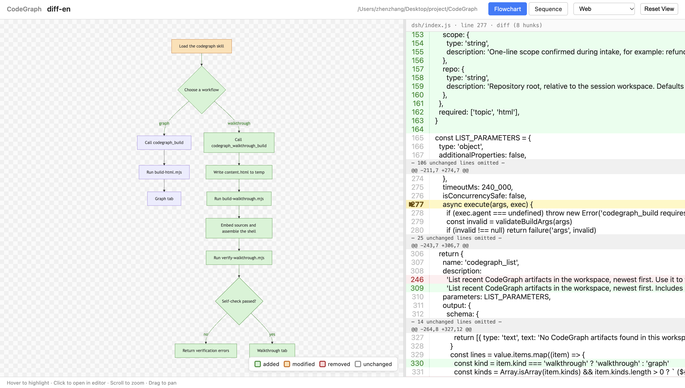
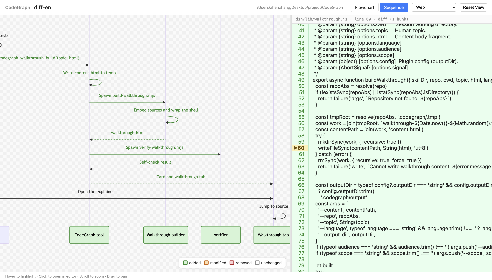
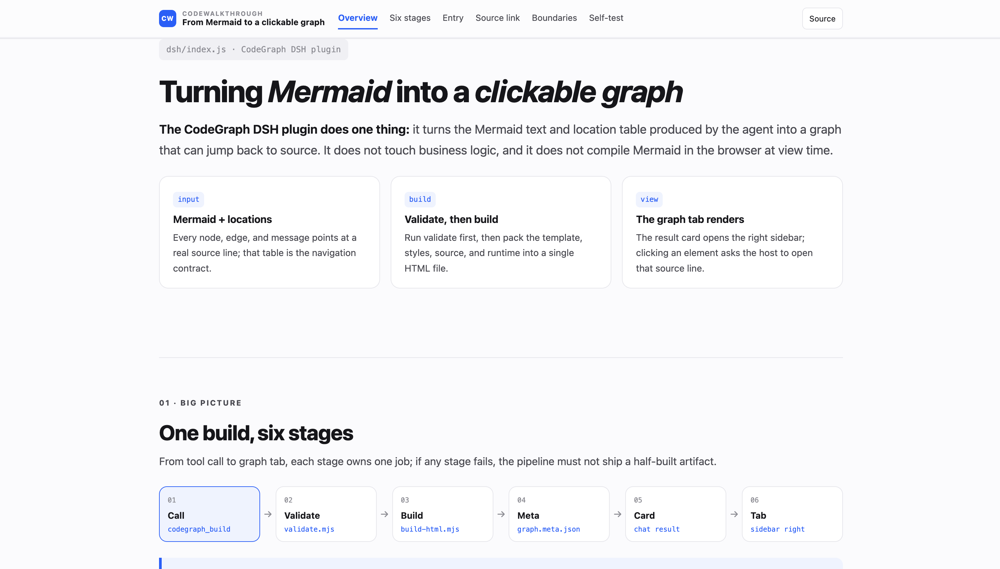

# CodeGraph

[English](README.md) · [中文](README.zh-CN.md)

> 把一段代码流程变成**可点击的图**，或一篇**可交互的长文讲解**——由 AI Agent 生成，产物是单个离线 HTML 文件。

CodeGraph 是一个 Agent Skill，适用于 Claude Code、DeepSeek Harness、Cursor、Codex 等兼容 Agent Skills 的工具。你只需描述流程，Agent 会阅读代码、生成产物，并让每个元素都能跳回源码。

## 为什么用 CodeGraph

普通 Mermaid 图到“一张图”就结束了。CodeGraph 保留了图和代码之间的连接：

- **点击跳源码**——点节点、边或时序消息，直接打开对应源码行；可以在编辑器里打开，也可以在页内面板查看。
- **带上下文 review**——把 PR、commit 或 `base..head` 范围交给 Agent，图里会用颜色标出新增 / 修改 / 删除的元素。
- **两种讲解方式**——要看结构就用流程图；要讲清楚一个模块，就用 **CodeWalkthrough** 生成可滚动的长文讲解页，带小节、内联图、源码链接和可选自测。

所有内容都会打包成一个自包含 HTML：不需要服务器、CDN，查看端也不需要 `npm install`，离线可用。

## 演示

**视频：** [观看 35 秒演示](https://github.com/longbowzz/CodeGraph/releases/download/v0.2.0/codegraph-demo.mp4) —— 输入 prompt、生成图、跳源码、打开讲解页，一次看完。

**Review 模式流程图。** 绿色为新增，橙色为修改，灰色为未变；点击节点会打开对应源码行。



**时序图。** 同样的 review 配色，包含参与者、消息和可点击的源码位置。



**CodeWalkthrough。** 带小节导航、源码链接和可选自测的长文页面。



## 两个主要功能

### 流程图

让 Agent 画一个流程，它会生成单个 `graph.html`：

- 流程图和 / 或时序图；
- 缩放、平移、hover 和点击跳源码；
- PR / commit / diff 的 review 模式；
- 任意浏览器可用，离线也能看。

### CodeWalkthrough

让 Agent 讲解一个模块或流程，它会生成单个 `walkthrough.html`：

- 上下滚动的长文，带小节和固定导航；
- 内联 SVG/CSS/JS 图和真实源码片段；
- 源码链接能打开对应文件和行；
- 可选 3–5 道自测题，附答案。

## 安装

### Claude Code

```bash
claude plugin marketplace add longbowzz/CodeGraph
claude plugin install codegraph@codegraph
```

在会话里也可以用 `/plugin install codegraph@codegraph --marketplace longbowzz/CodeGraph`
一步完成。

### 任意兼容 Agent Skills 的 Agent

```bash
npx skills add longbowzz/CodeGraph --skill codegraph
```

在目标项目里运行。加 `-g` 安装到全局，加 `-a claude-code` 跳过 Agent 选择。

### DeepSeek Harness

```bash
dsh plugin --profile web add -w @longbowzz/dsh-codegraph
```

`-w` 会把依赖加到 profile 的 workspace root；部分 DSH 构建下 pnpm 要求显式指定。这个 bundle 还会注册 `codegraph_build`、`codegraph_walkthrough_build`、`codegraph_list` 三个工具，以及结果卡片和右侧栏的图 / 讲解页 tab。详见 [`dsh/README.md`](dsh/README.md)。

### 环境要求

- **Node.js 18+**：运行 Skill 脚本；生成和查看产物不需要运行时 `npm install`。
- **Node.js 22.20+**：使用 `npx skills` CLI 时需要。
- 点击跳源码需要受支持的编辑器（VS Code、Cursor、JetBrains 系列）；没有的话选 **Web** 编辑器，在页内面板打开源码。
- **DeepSeek Harness 0.2.x**：使用 DSH bundle 时。

## 使用

在要分析的项目里直接对 Agent 说：

> 用 CodeGraph 画一下登录流程的时序图。

> 用 CodeGraph review 一下 PR #123，标出改动。

> 用 CodeGraph 为我介绍退款流程，做成一个可交互的网页。

第一次运行可能会问用哪个编辑器。没有安装受支持的编辑器时选 **Web**。

产物会写到目标项目的 `.codegraph/output/` 下。在 DSH 中，结果卡片会在右侧栏打开图或讲解页；其他 Agent 里直接打开它报告的 HTML 文件即可。

## 注意事项

- Agent 负责写 Mermaid 文本和源码位置表；校验器检查语法、结构、路径和行号，但不能证明标签的业务含义正确——这需要 Agent 阅读代码来保证。
- Review 配色：**绿色 = 新增**，**橙色 = 修改**，**灰色 = 未变**。
- 产物是当前 checkout 的快照；代码改动后需要重新生成。
- CodeWalkthrough 会先确认读者、范围和深度；自测题是可选项，需要明确要求。
- 在 DSH 中，被分析的仓库必须位于 session workspace 内。
- CodeGraph 不是通用的“画个图”触发器。请明确提到 CodeGraph，或要求 CodeWalkthrough，Skill 才会激活。

## 了解更多

- [Agent 规范](skills/codegraph/SKILL.md)——完整的画图流程和支持的 Mermaid 子集。
- [CodeWalkthrough 规范](skills/codegraph/references/walkthrough.md)——信息确认、页面结构和自检。
- [DeepSeek Harness 插件包](dsh/README.md)——工具、卡片、标签页和配置。
- [CodeWalkthrough 示例内容](skills/codegraph/examples/walkthrough-sample.html)。
- 有问题或建议？[提 Issue](https://github.com/longbowzz/CodeGraph/issues)。

## 开发

```bash
npm test          # parser、validator、diff、HTML 构建、CLI
npm run build:mermaid
```

浏览器测试需要 Playwright 和 Chromium；入口脚本见
[`skills/codegraph/scripts`](skills/codegraph/scripts)。

## 协议

MIT。见 [LICENSE](LICENSE)。
